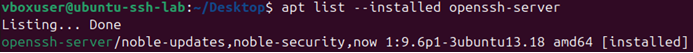
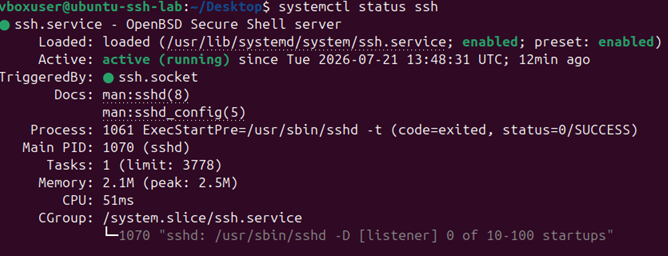
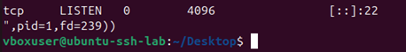
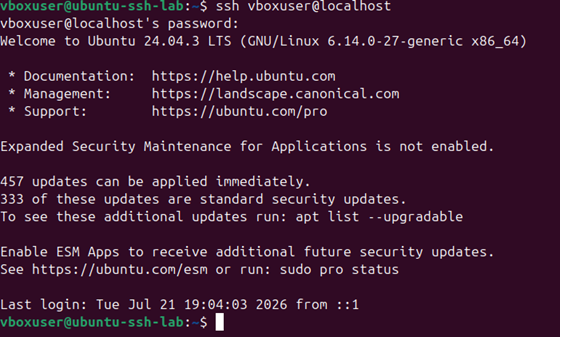
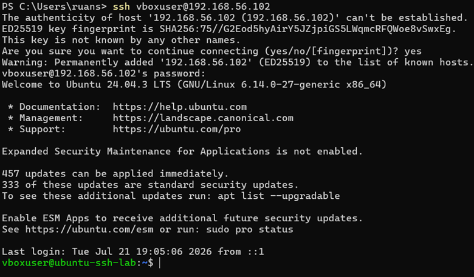

# 01 - Fundamentos de SSH

## Objetivo

Entender o funcionamento básico do SSH em um ambiente Linux e verificar se o serviço está instalado, ativo e acessível na máquina virtual Ubuntu.

Nesta etapa, o foco foi preparar o serviço que será usado para gerar eventos de autenticação nas próximas partes do projeto.

Antes de analisar logs, é importante confirmar que o SSH está funcionando corretamente, pois os eventos de login, falha de autenticação e acesso remoto serão registrados a partir desse serviço.

## O que é SSH

SSH significa Secure Shell.

Ele é um protocolo usado para acessar sistemas remotamente de forma segura. Em ambientes Linux, o SSH é muito comum para administração de servidores, execução de comandos remotos, transferência de arquivos e manutenção de ambientes de infraestrutura.

Diferente de protocolos antigos de acesso remoto, o SSH protege a comunicação usando criptografia. Isso ajuda a evitar que informações sensíveis, como credenciais e comandos executados, trafeguem em texto claro pela rede.

## Relação com infraestrutura

O SSH é bastante usado em ambientes de suporte, infraestrutura, redes, cloud e segurança.

Em uma rotina real, ele pode ser usado para:

- acessar servidores Linux;
- verificar serviços;
- consultar logs;
- alterar configurações;
- executar comandos administrativos;
- realizar troubleshooting remoto;
- apoiar investigações técnicas.

Por esse motivo, entender SSH é uma base importante antes de estudar logs de autenticação em Linux.

## Serviço utilizado

No Ubuntu, o serviço utilizado foi o OpenSSH Server.

Esse serviço permite que a máquina virtual aceite conexões SSH de outros hosts da rede.

A instalação foi feita com:

```bash
sudo apt update
sudo apt install openssh-server -y
```

Depois da instalação, foi verificado se o pacote estava presente no sistema:

```bash
apt list --installed openssh-server
```

## Verificação do serviço

Após a instalação, o status do serviço SSH foi consultado com:

```bash
systemctl status ssh
```

O serviço apareceu como ativo:

```text
Active: active (running)
```

Isso indica que o OpenSSH Server estava em execução na máquina virtual.

## Verificação da porta 22

Por padrão, o SSH utiliza a porta TCP 22.

Para verificar se o serviço estava escutando nessa porta, foi utilizado o comando:

```bash
sudo ss -tulnp 'sport = :22'
```

O resultado indicou que havia um processo escutando conexões TCP na porta 22.

Esse teste confirma que o serviço estava pronto para receber conexões SSH.

## Teste de conexão local

O primeiro teste de conexão foi feito dentro da própria VM, usando:

```bash
ssh vboxuser@localhost
```

Esse teste confirmou que o servidor SSH estava aceitando autenticação localmente.

Após inserir a senha do usuário, a sessão SSH foi iniciada com sucesso.

## Teste de conexão a partir do Windows

Depois do teste local, foi feita uma conexão a partir do Windows PowerShell para a VM Ubuntu usando o IP da interface Host-only:

```powershell
ssh vboxuser@192.168.56.102
```

Na primeira conexão, o cliente SSH exibiu um aviso informando que a autenticidade do host ainda não era conhecida.

Esse comportamento é esperado em uma primeira conexão SSH. Após confirmar com `yes`, a chave do servidor foi adicionada à lista de hosts conhecidos do cliente.

A conexão foi concluída com sucesso, confirmando que o Windows conseguia acessar a VM Ubuntu pela rede Host-only.

## Evidências

### OpenSSH Server instalado



### Serviço SSH ativo



### Porta 22 escutando



Obs.: No resultado, a porta apareceu como `[::]:22`. Isso indica que o serviço estava escutando na porta 22, aceitando conexões de rede para o SSH.

### Teste de conexão SSH local



### Teste de conexão SSH a partir do Windows



## O que foi observado

Durante esta etapa, foi possível confirmar que:

- o OpenSSH Server estava instalado;
- o serviço `ssh.service` estava ativo;
- a porta TCP 22 estava escutando;
- a conexão SSH local funcionou;
- a conexão SSH a partir do Windows funcionou usando o IP Host-only da VM.

Isso mostra que o ambiente está pronto para gerar eventos de autenticação SSH nas próximas etapas.

## Relação com logs e segurança defensiva

Cada tentativa de conexão SSH pode gerar registros nos logs de autenticação do Linux.

Esses registros podem indicar eventos como:

- login bem-sucedido;
- senha incorreta;
- tentativa com usuário inexistente;
- origem da conexão;
- horário da tentativa;
- método de autenticação utilizado.

Em segurança defensiva, esse tipo de log é importante para identificar erros de acesso, tentativas repetidas de autenticação e possíveis comportamentos suspeitos.

Por isso, antes de criar qualquer automação em Python, é necessário entender como o SSH funciona e como os eventos aparecem no sistema.

## Observações importantes

O SSH foi configurado apenas dentro de um laboratório local e controlado.

A VM possui uma interface NAT para acesso à internet e uma interface Host-only para comunicação entre o Windows e o Ubuntu.

O serviço SSH não foi exposto diretamente para a internet.

## Aprendizados

Nesta etapa, pratiquei:

- instalação do OpenSSH Server no Ubuntu;
- verificação de serviço com `systemctl`;
- verificação de porta com `ss`;
- conexão SSH local;
- conexão SSH remota a partir do Windows;
- uso da rede Host-only do VirtualBox;
- entendimento inicial da relação entre SSH e logs de autenticação.

## Conclusão

A etapa confirmou que o OpenSSH Server está instalado e funcionando corretamente na máquina virtual Ubuntu.

O serviço está ativo, escutando na porta 22 e acessível tanto localmente quanto a partir do Windows pela rede Host-only.

Com isso, o laboratório está pronto para a próxima etapa: localizar os logs de autenticação do Linux e observar como eventos SSH aparecem nos registros do sistema.