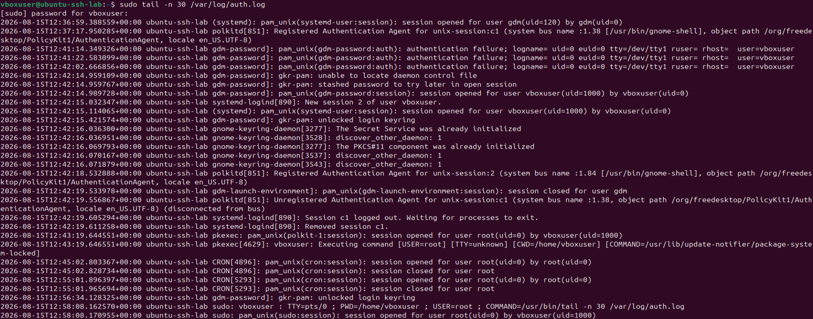
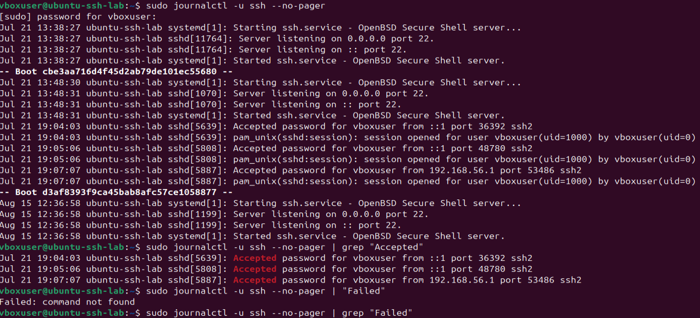

# 02 - Logs de autenticação no Linux

## Objetivo

Entender onde o Ubuntu registra eventos relacionados à autenticação e identificar como as conexões SSH aparecem nos registros do sistema.

Nesta etapa, o foco foi observar os logs antes de gerar novas tentativas de login. A ideia foi entender primeiro o comportamento normal do ambiente e relacionar os registros com as conexões SSH realizadas anteriormente.

## Logs utilizados

Durante a análise, foram observadas duas fontes principais de informação:

* `/var/log/auth.log`
* `journalctl -u ssh`

O arquivo `auth.log` reúne diversos eventos relacionados a autenticação e segurança do sistema, enquanto o `journalctl -u ssh` permite consultar especificamente os registros associados ao serviço SSH.

## Verificação do auth.log

A existência do arquivo foi verificada com:

```bash
ls -lh /var/log/auth.log
```

O arquivo estava presente no sistema:

```text
/var/log/auth.log
```

Ele pertence ao usuário `syslog` e ao grupo `adm`, com permissões que restringem o acesso direto ao conteúdo.

Por esse motivo, foi necessário utilizar `sudo` para consultar o arquivo.

## Análise das últimas linhas

Para observar os eventos mais recentes, foi utilizado:

```bash
sudo tail -n 30 /var/log/auth.log
```

O resultado mostrou que o `auth.log` não contém apenas eventos do SSH.

Foram encontrados registros relacionados a diferentes componentes do sistema, como:

* `gdm-password`;
* `systemd`;
* `polkitd`;
* `gnome-keyring-daemon`;
* `pkexec`;
* `sudo`;
* `cron`;
* `sshd`.

Também apareceram diferentes tipos de eventos, como falhas de autenticação, abertura e encerramento de sessões e execução de comandos administrativos.

Isso mostra que não seria correto interpretar qualquer linha contendo palavras como `Failed` ou `Accepted` como um evento de autenticação SSH.

## Um exemplo de falso positivo

Durante a análise, foi utilizado:

```bash
sudo grep "Failed" /var/log/auth.log
```

O resultado apresentou uma mensagem relacionada ao `dbus-daemon`:

```text
Failed to activate service 'org.bluez'
```

Esse evento contém a palavra `Failed`, mas não representa uma falha de autenticação SSH.

Também apareceram registros relacionados ao próprio comando `grep`, porque a utilização do `sudo` gera eventos no `auth.log`.

Esse comportamento foi importante para o projeto porque mostrou que uma detecção baseada apenas na presença de palavras-chave poderia gerar falsos positivos.

Por isso, o analisador futuro precisará considerar o contexto do evento, incluindo o processo responsável pelo registro e outras informações presentes na linha.

## Consulta ao serviço SSH com journalctl

Para observar especificamente os registros do SSH, foi utilizado:

```bash
sudo journalctl -u ssh --no-pager
```

Também foram consultados os últimos eventos com:

```bash
sudo journalctl -u ssh --no-pager -n 30
```

Diferentemente do `auth.log`, essa consulta apresentou somente registros relacionados ao serviço `ssh`.

Entre os eventos encontrados estavam:

```text
Server listening on 0.0.0.0 port 22.
Server listening on :: port 22.
Started ssh.service - OpenBSD Secure Shell server.
Accepted password for vboxuser from ::1 port 36392 ssh2
Accepted password for vboxuser from 192.168.56.1 port 53486 ssh2
```

## Interpretação dos eventos observados

### Serviço escutando na porta 22

Foram encontrados registros como:

```text
Server listening on 0.0.0.0 port 22.
Server listening on :: port 22.
```

Esses eventos indicam que o servidor SSH estava escutando na porta 22 em IPv4 e IPv6.

O endereço `0.0.0.0` representa todas as interfaces IPv4 disponíveis para escuta, enquanto `::` representa todas as interfaces IPv6.

### Autenticação local

Também foi observado:

```text
Accepted password for vboxuser from ::1 port 36392 ssh2
```

Esse evento corresponde ao teste realizado anteriormente na própria máquina:

```bash
ssh vboxuser@localhost
```

O endereço `::1` é o endereço de loopback IPv6, equivalente ao `127.0.0.1` no IPv4.

Nesse caso:

```text
Accepted password
→ autenticação aceita

vboxuser
→ usuário autenticado

::1
→ origem local

port 36392
→ porta de origem utilizada pelo cliente

ssh2
→ SSH versão 2
```

### Autenticação a partir do Windows

Também foi observado:

```text
Accepted password for vboxuser from 192.168.56.1 port 53486 ssh2
```

Esse evento corresponde ao teste realizado a partir do Windows utilizando a rede Host-only:

```powershell
ssh vboxuser@192.168.56.102
```

Nesse caso, o endereço `192.168.56.1` representa a origem da conexão na rede Host-only.

O evento mostra que a autenticação foi aceita e que a conexão SSH foi estabelecida com sucesso.

## Relação entre ação e registro

Uma das principais observações desta etapa foi a possibilidade de relacionar as ações realizadas no laboratório com os eventos registrados pelo sistema.

O fluxo observado foi:

```text
Teste SSH local
        ↓
ssh vboxuser@localhost
        ↓
::1
        ↓
Accepted password
```

E:

```text
Windows
   ↓
192.168.56.1
   ↓
ssh vboxuser@192.168.56.102
   ↓
Accepted password
```

Essa relação será importante nas próximas etapas, porque os eventos controlados serão gerados propositalmente e depois comparados com os registros produzidos pelo sistema.

## Diferença entre auth.log e journalctl

A análise mostrou uma diferença prática entre as duas fontes:

```text
/var/log/auth.log
→ reúne diversos eventos de autenticação e segurança do sistema

journalctl -u ssh
→ permite consultar especificamente os eventos do serviço SSH
```

O `auth.log` pode ser útil para uma análise mais ampla do sistema, mas também exige mais cuidado para separar os eventos relevantes.

O `journalctl -u ssh` é mais específico para observar o comportamento do serviço SSH.

## Evidências

### Localização do auth.log


### Últimas linhas do auth.log



### Registros do serviço SSH



## O que foi observado

Durante esta etapa, foi possível confirmar que:

* o Ubuntu possui o arquivo `/var/log/auth.log`;
* o `auth.log` reúne eventos de diferentes componentes do sistema;
* o serviço SSH possui registros próprios no `journalctl`;
* conexões SSH bem-sucedidas aparecem como `Accepted password`;
* o endereço `::1` apareceu na conexão local;
* o endereço `192.168.56.1` apareceu na conexão realizada a partir do Windows;
* palavras isoladas como `Failed` podem gerar resultados que não estão relacionados ao SSH;
* a análise dos logs precisa considerar o contexto de cada evento.

## Relação com segurança defensiva

Logs de autenticação são importantes para investigar acessos ao sistema e identificar comportamentos fora do padrão.

Em um cenário real, eventos como falhas repetidas de autenticação, tentativas com usuários inexistentes e logins inesperados podem indicar desde erros legítimos até comportamentos suspeitos.

Por isso, a análise não deve depender apenas de uma palavra-chave. É necessário considerar informações como:

```text
horário
usuário
processo
IP de origem
tipo de evento
resultado da autenticação
quantidade de tentativas
```

Esse tipo de análise será a base para as regras de detecção que serão implementadas posteriormente em Python.

## Aprendizados

Nesta etapa, pratiquei:

* localização e consulta do `auth.log`;
* leitura de logs com `tail`;
* busca de informações com `grep`;
* consulta de registros de serviço com `journalctl`;
* identificação de eventos relacionados ao `sshd`;
* interpretação de mensagens de autenticação SSH;
* diferença entre logs gerais de autenticação e registros específicos do serviço SSH;
* identificação de possíveis falsos positivos durante uma busca simples.

## Conclusão

A análise mostrou como o Ubuntu registra diferentes tipos de eventos de autenticação e como o SSH aparece nesses registros.

Foi possível relacionar os testes realizados anteriormente com eventos reais no sistema, identificando autenticações locais e conexões originadas pelo Windows.

Também ficou claro que uma análise baseada apenas em palavras-chave pode produzir resultados incorretos. Esse aprendizado será importante para a próxima etapa, em que serão gerados eventos controlados de autenticação e comparados com os registros produzidos pelo sistema.
