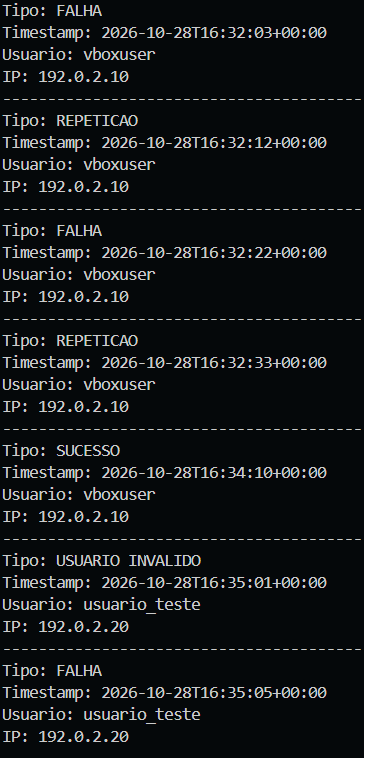
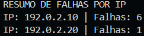
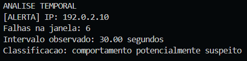
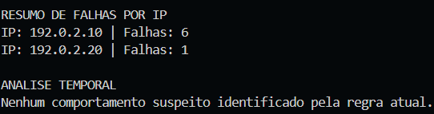
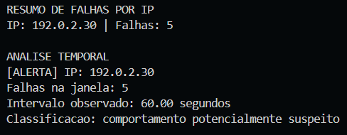
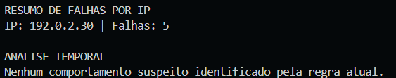
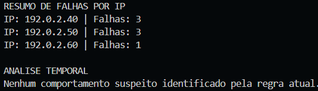

# 06 - Automação com Python

## Objetivo

Nesta etapa foi desenvolvido um analisador de logs SSH utilizando Python.

O objetivo foi automatizar a leitura e interpretação dos eventos de autenticação estudados anteriormente, permitindo identificar falhas, extrair informações relevantes e correlacionar eventos de acordo com a regra definida na Etapa 05.

A implementação foi realizada progressivamente, partindo da leitura de arquivos até a aplicação de uma janela temporal para identificação de comportamentos potencialmente suspeitos.

## Ferramentas utilizadas

- Python 3
- Biblioteca `re` (expressões regulares)
- Módulo `datetime`
- Módulo `pathlib`
- Módulo `sys`
- PowerShell
- VS Code
- Git e GitHub

Foram utilizadas apenas bibliotecas da própria linguagem Python, sem dependências externas.

## Organização dos arquivos

O código principal está localizado em:

`src/ssh_log_analyzer.py`

Os dados de teste estão armazenados em `data/`, incluindo:

- `sample-auth.log`: cenário principal de detecção.
- `teste-acima-60s.log`: falhas distribuídas em intervalos superiores ao limite.
- `teste-limite-60s.log`: validação dos limites temporais.
- `teste-multiplos-ips.log`: falhas provenientes de diferentes IPs.
- `teste-repeticoes-nao-falhas.log`: validação de mensagens repetidas que não representam falhas.

Os arquivos contêm dados fictícios ou adaptados para utilização pública.

## Funcionamento do analisador

O programa executa as seguintes operações:

1. Recebe o nome do arquivo de log.
2. Lê o conteúdo do arquivo.
3. Identifica registros relacionados ao processo `sshd`.
4. Classifica os eventos de autenticação.
5. Extrai timestamp, usuário e IP de origem.
6. Calcula a quantidade de falhas representada por cada registro.
7. Agrupa as falhas por endereço IP.
8. Organiza os eventos cronologicamente.
9. Aplica a regra de detecção utilizando uma janela de 60 segundos.
10. Apresenta os resultados no terminal.

### Identificação dos eventos

Foram considerados os seguintes padrões:

- `Failed password`: falha de autenticação.
- `Accepted password`: autenticação bem-sucedida.
- `Invalid user`: tentativa envolvendo usuário inexistente.
- `Failed password for invalid user`: falha de autenticação para usuário inexistente.
- `message repeated N times`: registro agrupado de mensagens repetidas.

A interpretação utiliza expressões regulares para reconhecer os formatos previstos e extrair os campos relevantes.

Registros que não correspondem aos formatos esperados são ignorados.

### Contabilização das falhas

Uma linha contendo `Failed password` normalmente representa uma falha.

Entretanto, o mecanismo de logging pode agrupar mensagens repetidas. Por exemplo:

```text
message repeated 2 times: [Failed password ...]
```

Nesse caso, a linha representa duas ocorrências adicionais.

O analisador extrai essa quantidade e a acrescenta à contagem do endereço IP correspondente.

Mensagens repetidas de autenticação bem-sucedida ou de `Invalid user` não são contabilizadas como falhas.

Também foi considerado que uma tentativa envolvendo usuário inexistente pode produzir tanto `Invalid user` quanto `Failed password for invalid user`.

O programa contabiliza a falha registrada em `Failed password for invalid user`, evitando duplicidade nesse cenário.

## Regra de detecção

A regra implementada foi definida na Etapa 05:

```text
5 ou mais falhas de autenticação
originadas do mesmo IP
dentro de uma janela de 60 segundos
```

Para aplicar essa regra, foi utilizada uma janela deslizante (*sliding window*).

A cada novo registro, o programa acrescenta as falhas correspondentes à janela e remove os eventos que estão a mais de 60 segundos do registro atual.

Quando a quantidade de falhas dentro da janela atinge cinco ou mais, é gerado um alerta para aquele endereço IP.

Nesta versão, é emitido apenas o primeiro alerta encontrado para cada IP.

## Organização do código

Após a implementação inicial, o script foi refatorado em funções:

| Função | Responsabilidade |
|---|---|
| `calcular_quantidade_falhas()` | Determinar quantas falhas uma linha representa |
| `interpretar_linha()` | Classificar registros e extrair informações |
| `ler_eventos()` | Ler o arquivo e organizar os registros reconhecidos |
| `organizar_falhas()` | Agrupar falhas e horários por IP |
| `detectar_alertas()` | Aplicar a regra de detecção temporal |
| `exibir_resultados()` | Apresentar os resultados |
| `main()` | Coordenar a execução do programa |

Essa divisão facilita a manutenção, a realização de testes e futuras melhorias.

## Execução

O analisador pode ser executado a partir da pasta principal do projeto.

Para utilizar o arquivo padrão:

```powershell
python3 src/ssh_log_analyzer.py
```

Para analisar um arquivo específico da pasta `data/`:

```powershell
python3 src/ssh_log_analyzer.py teste-multiplos-ips.log
```

O programa apresenta os eventos reconhecidos, a contagem total de falhas por IP e os alertas identificados.

## Testes realizados

Foram utilizados diferentes cenários para validar o comportamento da implementação.

| Cenário | Resultado esperado | Resultado |
|---|---|---|
| 6 falhas em aproximadamente 30 segundos | Gerar alerta | Aprovado |
| 6 falhas divididas em grupos separados por mais de 60 segundos | Não gerar alerta | Aprovado |
| 5 falhas em exatamente 60 segundos | Gerar alerta | Aprovado |
| 5 falhas em 61 segundos | Não gerar alerta | Aprovado |
| Falhas distribuídas entre diferentes IPs | Não somar IPs distintos | Aprovado |
| `Invalid user` acompanhado de falha | Não contar duas vezes | Aprovado |
| Repetições de eventos que não são falhas | Não contabilizar como falhas | Aprovado |

Os testes demonstraram que a implementação apresentou o comportamento esperado nos cenários sintéticos avaliados.

## Exemplo de resultado

No cenário principal, o programa identificou:

```text
RESUMO DE FALHAS POR IP
IP: 192.0.2.10 | Falhas: 6
IP: 192.0.2.20 | Falhas: 1

ANALISE TEMPORAL
[ALERTA] IP: 192.0.2.10
Falhas na janela: 6
Intervalo observado: 30.00 segundos
Classificacao: comportamento potencialmente suspeito
```

A classificação indica que o comportamento atingiu o critério definido para investigação, mas não confirma um ataque.

## Limitações identificadas

A implementação foi desenvolvida para fins educacionais e apresenta limitações importantes:

- Reconhece apenas os formatos de log previstos nos testes.
- Utiliza timestamps em formato ISO 8601.
- A extração de endereços IP contempla IPv4, sem validação completa do endereço.
- Não contempla todos os métodos de autenticação SSH.
- Não recupera os horários individuais das mensagens agrupadas por `message repeated`.
- Atribui as repetições ao timestamp do registro agrupado, o que pode afetar a precisão da janela temporal.
- Emite apenas o primeiro alerta identificado para cada IP.
- Não incorpora contexto externo ou mecanismos avançados de correlação.

Consequentemente, o programa pode produzir falsos positivos ou falsos negativos em situações não contempladas pelos testes.

A regra de cinco falhas em 60 segundos é uma heurística definida para o laboratório, não um padrão universal de segurança.

## Privacidade e uso responsável

O desenvolvimento utiliza exclusivamente dados fictícios ou produzidos em ambiente próprio e controlado.

Logs originais são mantidos em `logs-local/`, fora do repositório público.

O projeto não realiza tentativas de autenticação, ataques ou alterações nos sistemas analisados. Sua função é interpretar registros previamente disponíveis.

## Aprendizados

Esta etapa permitiu praticar:

- Leitura de arquivos com Python.
- Manipulação de strings.
- Expressões regulares.
- Funções e organização modular.
- Dicionários, listas e tuplas.
- Conversão e comparação de timestamps.
- Correlação temporal de eventos.
- Implementação de janela deslizante.
- Testes positivos, negativos e de limite.

Também ficou evidente a importância de validar diferentes cenários antes de considerar uma regra de detecção confiável.

## Conclusão

Foi desenvolvido um analisador capaz de interpretar registros SSH, extrair informações relevantes, contabilizar falhas por endereço IP e identificar conjuntos de eventos que atendam à regra temporal estabelecida.

Os testes realizados apresentaram os resultados esperados nos cenários avaliados.

A próxima etapa do projeto consiste em organizar as informações identificadas em relatórios, tornando os resultados mais úteis para documentação e investigação.


## Evidências

As evidências desta etapa demonstram o desenvolvimento e a validação do analisador de logs SSH em Python, desde a extração de informações até a aplicação da regra de detecção temporal.

Os testes foram realizados utilizando registros fictícios, permitindo verificar diferentes comportamentos de autenticação sem expor informações sensíveis.

### 1. Extração de informações dos registros SSH

A primeira implementação permitiu identificar e extrair informações relevantes dos registros, incluindo tipo de evento, timestamp, usuário e endereço IP de origem.



### 2. Contabilização de falhas por endereço IP

O analisador foi aprimorado para contabilizar as falhas de autenticação por endereço IP, considerando também mensagens agrupadas pelo mecanismo de logging.



### 3. Detecção de comportamento potencialmente suspeito

No cenário principal, o programa identificou seis falhas de autenticação originadas do mesmo IP, com registros concentrados em aproximadamente 30 segundos.

O comportamento atingiu o limite estabelecido e gerou o alerta esperado.



### 4. Falhas distribuídas em intervalos superiores a 60 segundos

Foi realizado um teste com seis falhas divididas em dois grupos temporalmente separados.

Embora a quantidade total tenha permanecido igual, nenhuma janela de 60 segundos atingiu o limite necessário para gerar um alerta.



### 5. Validação do limite exato de 60 segundos

Foram simuladas cinco falhas de autenticação com intervalo de exatamente 60 segundos entre a primeira e a última ocorrência.

O programa gerou corretamente um alerta, confirmando que o limite temporal é inclusivo.



### 6. Validação do limite de 61 segundos

No teste seguinte, o intervalo entre a primeira e a última falha foi aumentado para 61 segundos.

Como nenhuma janela de 60 segundos continha cinco falhas, o programa não gerou alerta.



### 7. Separação de falhas por IP e tratamento de usuários inexistentes

O último cenário apresentado utilizou falhas distribuídas entre diferentes endereços IP, incluindo uma tentativa de autenticação envolvendo um usuário inexistente.

O analisador contabilizou as falhas separadamente por IP e não duplicou a contagem da tentativa associada aos registros `Invalid user` e `Failed password for invalid user`.

Nenhum endereço atingiu individualmente o limite necessário para gerar alerta.



### Síntese das evidências

Os resultados demonstraram que o analisador apresentou o comportamento esperado nos cenários testados, incluindo detecções positivas, ausência de alertas, verificação de limites temporais e separação de eventos por endereço IP.

As evidências também reforçam a importância de considerar a estrutura dos registros e o intervalo entre os eventos, em vez de utilizar apenas a quantidade total de falhas como critério de detecção.

Esses resultados validam o funcionamento da implementação nos cenários avaliados, respeitando as limitações descritas anteriormente.
