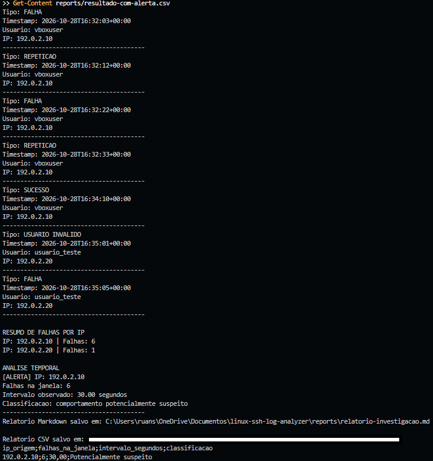
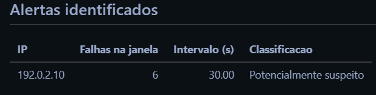
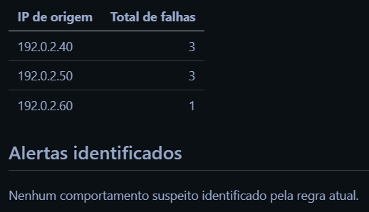

# 07 — Relatório de Investigação

## Objetivo

Nesta etapa, o analisador de logs SSH desenvolvido em Python foi ampliado para gerar relatórios estruturados em CSV e Markdown.

O objetivo foi registrar os resultados da detecção automatizada e realizar uma interpretação técnica dos eventos identificados, considerando a regra estabelecida na Etapa 05.

Todos os cenários apresentados utilizam registros fictícios, desenvolvidos para fins educacionais.

## 1. Geração dos relatórios

Foram implementadas duas funcionalidades adicionais no arquivo `src/ssh_log_analyzer.py`.

### Relatório CSV

A função `gerar_relatorio_csv()` exporta os alertas identificados para um arquivo CSV, contendo:

- Endereço IP de origem.
- Quantidade de falhas na janela temporal.
- Intervalo observado em segundos.
- Classificação do comportamento.

O arquivo permite consultar os resultados em ferramentas como Excel e realizar outros tipos de processamento de dados.

### Relatório Markdown

A função `gerar_relatorio_markdown()` produz um resumo técnico contendo:

- Arquivo de log analisado e momento da execução.
- Quantidade de registros SSH reconhecidos.
- Total de falhas de autenticação contabilizadas.
- Quantidade de IPs associados às falhas.
- Regra de detecção aplicada.
- Alertas identificados.
- Limitações da análise e conclusão automática.

Os relatórios são gravados na pasta `reports/`.

## 2. Cenário com alerta

**Arquivo analisado:** `data/sample-auth.log`

O cenário principal contém registros fictícios de autenticações SSH bem-sucedidas, falhas de autenticação, usuário inexistente e mensagens agrupadas.

### Resultados da análise automatizada

| Indicador | Resultado |
|---|---:|
| Registros SSH reconhecidos | 7 |
| Falhas de autenticação contabilizadas | 7 |
| IPs com falhas | 2 |
| IPs que geraram alerta | 1 |

A contagem por endereço IP apresentou os seguintes resultados:

| IP de origem | Total de falhas | Alerta |
|---|---:|---|
| `192.0.2.10` | 6 | Sim |
| `192.0.2.20` | 1 | Não |

O endereço `192.0.2.10` atingiu o critério de cinco ou mais falhas em uma janela de até 60 segundos.

O analisador identificou seis falhas distribuídas entre registros com timestamps separados por aproximadamente 30 segundos.

### Interpretação técnica

A concentração de falhas de autenticação em um intervalo curto pode indicar diferentes situações, incluindo erros repetidos de credenciais, falhas em processos automatizados ou tentativas de adivinhação de senha.

No cenário analisado, o comportamento atingiu o limite definido para identificação de atividade potencialmente suspeita.

Entretanto, esse resultado não comprova, isoladamente, a existência de um ataque.

A classificação indica a necessidade de investigação adicional.

### Autenticação bem-sucedida posterior

O conjunto de dados também apresenta uma autenticação bem-sucedida às 16:34:10 UTC, associada ao mesmo usuário e endereço IP que produziram as seis falhas anteriores.

Essa sequência merece atenção porque múltiplas falhas seguidas de sucesso podem representar um comportamento relevante para investigação.

Contudo, a regra atualmente implementada considera apenas o número de falhas dentro da janela temporal. Ela não realiza correlação específica entre falhas e autenticações posteriores bem-sucedidas.

Portanto, a autenticação bem-sucedida foi identificada durante a interpretação dos registros, e não por um alerta específico do programa.

Como os registros são fictícios, não é possível concluir que houve comprometimento de uma conta.

## 3. Cenário sem alerta

**Arquivo analisado:** `data/teste-multiplos-ips.log`

Neste cenário, foram utilizadas sete falhas de autenticação distribuídas entre três endereços IP.

| IP de origem | Total de falhas |
|---|---:|
| `192.0.2.40` | 3 |
| `192.0.2.50` | 3 |
| `192.0.2.60` | 1 |

Nenhum endereço IP atingiu individualmente o limite de cinco falhas dentro da janela de 60 segundos.

Consequentemente, o analisador não gerou alertas.

O resultado demonstra que a implementação não considera apenas o total de falhas do arquivo, mas também a origem e a distribuição temporal dos eventos.

A ausência de alertas significa apenas que o critério implementado não foi atingido. Ela não garante a inexistência de atividade maliciosa.

## 4. Comparação dos cenários

| Critério | Com alerta | Sem alerta |
|---|---|---|
| Arquivo | `sample-auth.log` | `teste-multiplos-ips.log` |
| Total de falhas | 7 | 7 |
| IPs com falhas | 2 | 3 |
| Maior contagem por IP | 6 | 3 |
| Alertas gerados | 1 | 0 |

Apesar de ambos os cenários apresentarem sete falhas, apenas um atingiu o critério de detecção.

Essa comparação demonstra a importância da correlação entre endereço IP, quantidade de falhas e intervalo temporal.

## 5. Limitações da investigação

A análise apresenta limitações que devem ser consideradas na interpretação dos resultados.

- Os registros utilizados são fictícios e não representam um incidente real.
- O analisador reconhece apenas os formatos de logs contemplados pela implementação.
- O programa não realiza correlação específica entre falhas e autenticações bem-sucedidas.
- As mensagens agrupadas utilizam o timestamp do registro de repetição, sem recuperar o horário individual de cada ocorrência.
- A implementação gera somente o primeiro alerta identificado por endereço IP.
- Não foram consultadas informações adicionais, como inventário de ativos, histórico de acessos, localização de origem ou contexto operacional.
- A regra utilizada é uma heurística educacional, não sendo suficiente para comprovar ataques.

Essas limitações impedem conclusões definitivas sobre comprometimento, intenção ou legitimidade das autenticações.

## 6. Recomendações preliminares

Em uma investigação real envolvendo comportamento semelhante, seria recomendável:

1. Verificar se o endereço IP de origem é conhecido e autorizado.
2. Conferir os horários e a frequência das tentativas de autenticação.
3. Investigar a legitimidade de autenticações bem-sucedidas posteriores às falhas.
4. Correlacionar os registros SSH com outras fontes de logs disponíveis.
5. Verificar as configurações de autenticação e os controles de acesso existentes.

As recomendações são apresentadas como possibilidades de investigação, não como medidas aplicadas ao ambiente do laboratório.

A análise das configurações de segurança e das medidas de proteção será aprofundada na Etapa 08.

## 7. Conclusão

A Etapa 07 permitiu ampliar o SSH Log Analyzer com funcionalidades de geração de relatórios em CSV e Markdown.

Os resultados demonstraram que o programa consegue registrar os alertas identificados e produzir um resumo técnico das análises realizadas.

A comparação entre os cenários com e sem alertas evidenciou a importância de considerar a origem das falhas e sua distribuição temporal.

A interpretação do cenário principal também identificou uma autenticação bem-sucedida posterior às falhas, mostrando que a análise humana pode identificar informações relevantes que ainda não são contempladas pelas regras automatizadas.

O desenvolvimento reforçou a importância de diferenciar eventos registrados, alertas automatizados, hipóteses investigativas e conclusões sustentadas por evidências.

Na próxima etapa, serão estudadas medidas de fortalecimento da segurança SSH, controles preventivos e recomendações de mitigação.

## 8. Evidências

### 8.1 Relatório CSV com alerta

O relatório CSV apresentou o endereço IP identificado, a quantidade de falhas, o intervalo observado e a classificação do comportamento.

### 8.2 Relatório técnico com alerta

O relatório Markdown reuniu os indicadores da análise, a contagem por IP, os alertas identificados e as limitações da detecção.

### 8.3 Relatório técnico sem alerta

O cenário negativo demonstrou que o programa também produz relatórios quando nenhum endereço IP atende ao critério de detecção.

